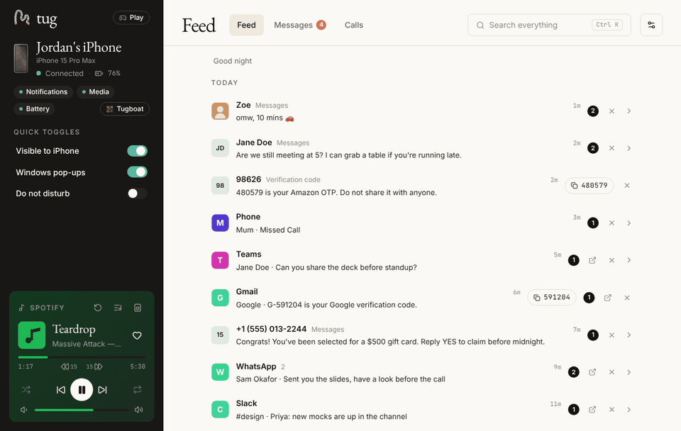
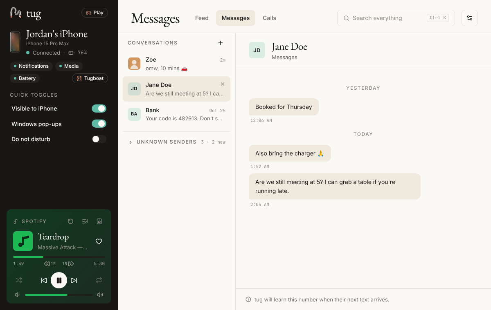
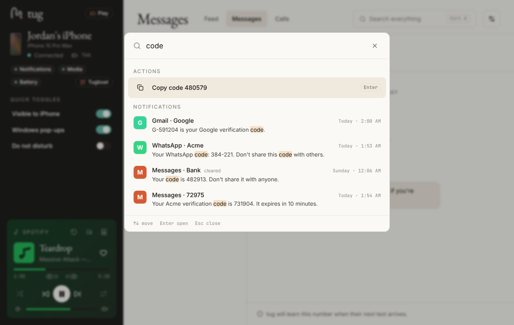
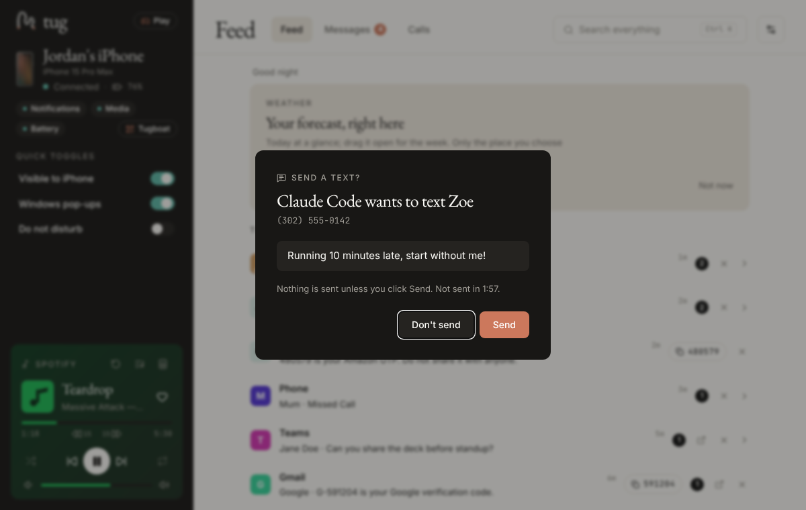
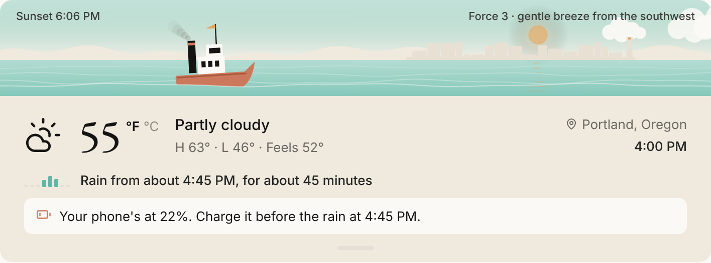

<div align="center">

# tug

**Your iPhone on your Windows PC.** Notifications, texts, calls and music over Bluetooth.<br>
No app on the phone, no account, no cloud.

[](https://github.com/Davenee12/tug/releases/latest)

Windows 10 (2004 or later) or 11 · an iPhone · free and open source · [What's new](CHANGELOG.md)



</div>

- **Your phone's notifications and texts, on your PC.** Read and reply from your keyboard, get
  Windows pop-ups you can act on, and copy verification codes in one click.
- **Music, calls and files without picking up the phone.** Now Playing with your media keys,
  incoming calls and missed-call call-backs, and photos and files over Wi-Fi with Tugboat.
- **Built for developers, too.** Claude Code, Cursor, Codex and VS Code can read your newest 2FA
  code or search your texts through tug, and can only send a text after you click **Send**.

## Download

1. Download **`tug-<version>-setup.exe`** from the
   **[latest release](https://github.com/Davenee12/tug/releases/latest)**. It installs for your
   Windows account only, with no admin rights needed (there's a portable exe there too).
2. Open it and follow **Connect your iPhone** ([Quick start](#quick-start)).

### Windows may warn you. Here's why, and why it's safe

The installer isn't **code-signed** yet. Signing certificates cost money, and free signing for
open-source projects is on the [roadmap](ROADMAP.md). Until then, Windows says it doesn't recognise
the publisher:

- **SmartScreen** shows "Windows protected your PC". Click **More info**, then **Run anyway**.
- **Smart App Control** (on by default on some fresh Windows 11 installs) may block unsigned apps
  with no Run anyway. If it does, tug can't be installed on that PC until releases are signed.
  Turning Smart App Control off may not be reversible without resetting Windows, so think twice.

Why you can trust the download anyway:

- **Everything is open source**, here in this repository: read exactly what tug does.
- **Releases are built by GitHub, not on someone's PC.** Every installer comes from
  [a public workflow](.github/workflows/release.yml) run on GitHub's servers, from a tagged commit on
  `main`; anyone can see the run that made it.
- **You can check your file is the real one.** Each release lists SHA-256 checksums. In PowerShell,
  in the folder you downloaded it to, `Get-FileHash .\tug-*-setup.exe` must print the same value as
  the release notes.
- **Updates are signed.** tug only installs an update signed with its own key, so nobody can slip
  in a changed version.
- **Nothing about you leaves your PC.** No servers, no account, no analytics, no telemetry
  ([Privacy](#privacy)).

## Everything tug does

- **Notifications** from every app, with Windows pop-ups you can act on, quiet hours and VIPs.
- **Texts:** read them the moment they arrive and reply from your keyboard, with verification codes
  ready to copy.
- **Calls:** an incoming-call card, recent calls, and call back a missed call.
- **Music:** Now Playing with controls, Windows media keys, and an optional Spotify panel.
- **Tugboat:** photos, files and text between your phone and PC over Wi-Fi, no app needed.
- **Ctrl+K** search across people, texts and notifications, plus quick actions.
- **Weather as a live harbor:** the real sun, moon phase and wind where you are, rain to the
  quarter-hour, and a heads-up to charge your phone when rain is coming and it's low.
- **For developers:** your AI tools (Claude Code, Codex, Cursor, VS Code) and a `tug` command can
  use your phone, always with you in charge.

<p align="center">
  
  
  
</p>

<p align="center">
  
</p>

[Website](https://davenee12.github.io/tug/) · [What's changed](CHANGELOG.md) · [Everything tug can do, in detail](docs/FEATURES.md) · [Roadmap](ROADMAP.md)

## Requirements

- **Windows 10 version 2004 or later, or Windows 11**, on an x64 PC. ARM64 PCs run it under
  emulation, untested.
- **A Bluetooth LE adapter that can act as a peripheral.** Most Bluetooth 5 adapters can; some
  Realtek, MediaTek and older adapters can't. tug tells you if yours can't (a Bluetooth 5 USB
  adapter fixes it).
- **An iPhone.** Android phones can't pair with tug yet (Tugboat works from Android browsers).
- **WebView2 Runtime**, already part of Windows 11 and up-to-date Windows 10.
- The app is in **English** only for now.
- Tugboat needs an **IPv4 home or office network** set to **Private** in Windows.

## Quick start

tug opens with a **Connect your iPhone** panel (also in Settings › iPhone):

1. On the iPhone, open **Settings › Bluetooth** and keep it open. tug lists your phone by name.
2. Click **Pair**, check the code in tug matches the phone, and confirm. That one pairing brings
   notifications, music, battery and texts.
3. Tap **Allow** on the iPhone when it asks, then turn on the switches tug shows (iPhone
   Settings › Bluetooth › ⓘ next to this PC): **Share System Notifications** for the Feed, **Show
   Notifications** for texts, and **Sync Contacts** for names, photos and calls. tug turns each one
   green as it comes on.

Good to know:
- Message text missing from notifications? iOS only shares what the lock screen shows: set
  iPhone Settings › Notifications › Show Previews to **Always**.
- After the iPhone restarts, nothing connects until it's unlocked once; tug says "Unlock your
  iPhone" and reconnects by itself.
- On a fresh install, iOS shares only the 10 newest incoming texts, and never texts sent from the
  phone itself. Everything after that is kept in tug's history.

## Features

The full list, area by area, with what iOS doesn't allow: **[docs/FEATURES.md](docs/FEATURES.md)**.

**Spotify:** the Spotify connector (Settings › Connectors) is an **invite-only beta**. tug's
Spotify app is in Spotify's Development Mode, which allows only 5 accounts added by hand, and
playback controls need Spotify Premium. The phone's own music controls work for everyone.

## Developer tools

Turn on **Settings › Developer tools › Let AI tools use tug** (off by default) and your AI tools can
use your phone through tug's local MCP server: the newest 2FA code, a search of your texts and
notifications, GitHub/CI/deploy notifications, Tugboat files (a phone screenshot straight into the
agent), what's playing, and texts that are only sent after you click **Send** in tug. Codes, music
and texts each start switched off. Setup is copy-paste from that page, for example:

```bash
claude mcp add --scope user tug -- "C:\Users\<you>\AppData\Local\tug\bin\tug.exe" mcp
```

In a terminal: `tug code --copy`, `tug boat screenshot.png`, `tug text Sam "On my way"`,
`tug next` to skip the song, `tug now`, `tug status`. Setup for Codex, Cursor and VS Code, the safety model and troubleshooting:
**[docs/DEVELOPERS.md](docs/DEVELOPERS.md)**.

## Privacy

tug has **no servers, no account, no analytics and no telemetry**. It talks to your iPhone over
Bluetooth and keeps your history (notifications, texts, contacts, settings) in a database on your
PC, in `%APPDATA%\dev.davejames.tug`.

What goes online, and only when you use it:
- **Weather** (if you set it up): forecasts from Open-Meteo for your place rounded to about 1 km;
  "Use my location" names the place through BigDataCloud.
- **App icons** (on by default, switchable): Apple's App Store lookup, sending only the app's
  identifier.
- **Album art** (on by default, switchable): Apple's music catalog, sending only the artist and
  album name.
- **Spotify**, only if you connect it.

Tugboat stays on your local network, and the developer bridge only accepts programs on your PC
running as you. Copy diagnostics removes numbers, names and message text before anything reaches
the clipboard. Full details, and how to delete everything: **[docs/PRIVACY.md](docs/PRIVACY.md)**.

## Build from source

**Prerequisites** (Windows 10/11):
- [Node.js](https://nodejs.org) 22 LTS
- [Rust](https://rustup.rs) stable, with `clippy` and `rustfmt`
- Visual Studio Build Tools with **Desktop development with C++** and a **Windows 10/11 SDK** (it
  provides `RC.EXE`, which the build needs)
- WebView2 Runtime (already on Windows 11)

```bash
npm install
npm run dev            # the UI in a browser with sample data, no phone needed (src/lib/devMock.ts)
npm run tauri dev      # the real app, with Bluetooth
npm run check          # Tugboat page build + vue-tsc + vitest + cargo fmt + clippy -D warnings + cargo test
npm run build:release  # installer: src-tauri/target/release/bundle/nsis/tug_<version>_x64-setup.exe
```

Use `npm run build:release` rather than a bare `npx tauri build`: it also builds the `tug` command
and strips local paths (your user folder) from the exes. Browser preview scenarios (`/?setup`,
`/?call`, `/?whatsnew`, …) and how tug fits together are in
**[docs/ARCHITECTURE.md](docs/ARCHITECTURE.md)**.

**Spotify in your own build:** tug's Spotify Client ID is built in as `CLIENT_ID` in
`src-tauri/src/spotify/mod.rs`. A fork should create its own app in the
[Spotify developer dashboard](https://developer.spotify.com/dashboard), register the redirect URI
`http://127.0.0.1:8972/callback`, add its listeners while in Development Mode, and put its own
Client ID there.

## Support tug

tug is free and open source, and stays that way. If it saves you time, you can
[sponsor its development on GitHub](https://github.com/sponsors/Davenee12). Sponsorships go
first towards code signing, so Windows stops warning about the installer.

## Contributing

Bug reports, fixes and ideas are welcome. Read **[CONTRIBUTING.md](CONTRIBUTING.md)** for setup,
the branch and pull request flow, and the rules that keep tug honest (logic in pure modules with
tests, `npm run check` passing, no personal data in fixtures). Everyone taking part follows the
[Code of Conduct](CODE_OF_CONDUCT.md).

## Security

Please report vulnerabilities privately through the repository's **Security** tab (**Report a
vulnerability**), not in public issues. Scope and what to expect: **[SECURITY.md](SECURITY.md)**.

## License

[MIT](LICENSE) © 2026 tug contributors.

**Trademark:** the MIT licence covers the code, not the name. The **tug** name and logo are the
owner's. If you publish a fork, please give it a different name and icon so people don't confuse it
with tug.

tug isn't affiliated with or endorsed by Apple, Microsoft or Spotify. iPhone is a trademark of
Apple Inc.
